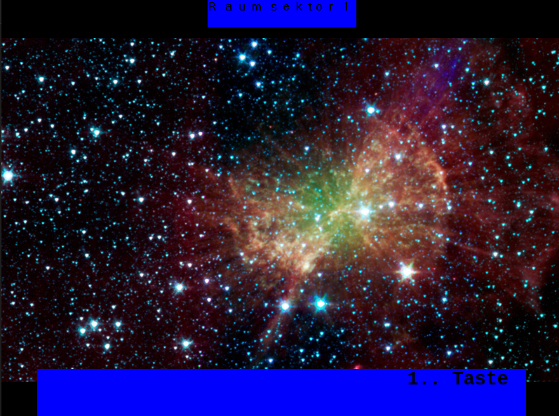
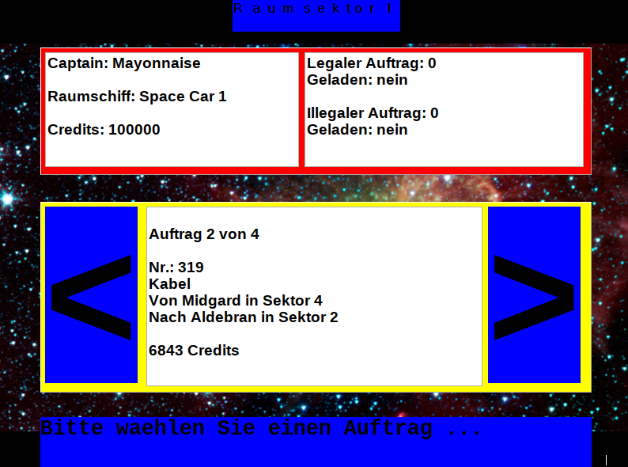
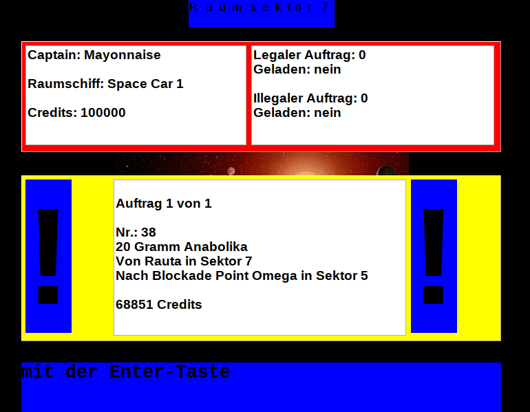
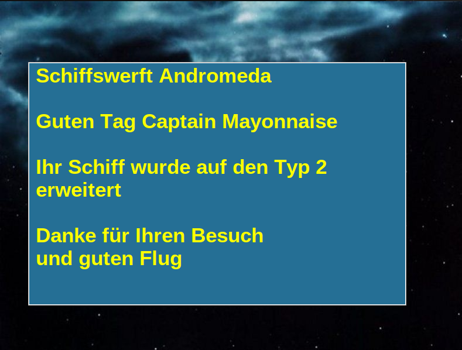
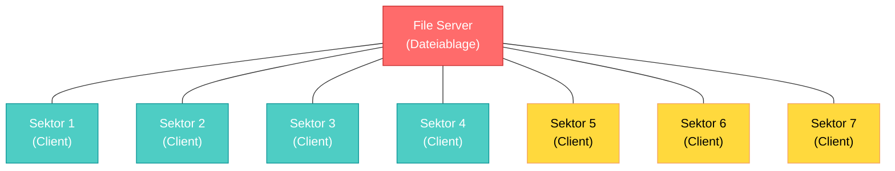

# Space

Space ist ein Spiel, bei dem man mit einer Gruppe einen Wettkampf darum macht, wer am meisten (virtuelles) Geld als Weltraumpirat erwirtschaften kann. Dabei ist es entscheidend welche Aufträge man annimmt, ob man sich traut illegale Aufträge anzunehmen (aber Achtung vor der Weltraumpolizei!) und manchmal auch wer am schnellsten rennt. 

## Description

Das Spiel wird mithilfe von NFC-Chips (Raumschiffen) gespielt. Ein Spieler geht von Sektor(Client) zu Sektor um Aufträge anzunehmen und zu erledigen. 

Ein Spieler kann auch illegale Aufträge annehmen. Dafür braucht er zuerst einen Code, der via physischer Liste vorhanden ist. Sobald ein Spieler einen Code erlangt hat, kann er damit zu einem illegalen Sektor und dort Eintritt erlangen. 

Nur sollte man gefasst sein, wenn man illegale Fracht geladen hat, denn die Polizei ist einem schon auf den Fersen!

Wenn man nach einiger Zeit genug Geld gesammelt hat, dann kann man sein Raumschiff auch aufwerten um noch schneller Geld zu verdienen. 

### Features 
- Echtzeit-Mehrspieler-Spiel: Spiele gegen 50+ andere Spieler gleichzeitig
- Aufträge annehmen und erfüllen: Wähle aus verschiedenen Aufträgen und verdiene Geld
- Raumschiff-Upgrades: Verbessere dein Raumschiff, um lukrativere Aufträge freizuschalten
- Illegale Aufträge: Höhere Verdienste in den Schwarzmarkt-Sektoren (mit Risiko)
- Polizei-Kontrollen: Mobile Polizisten können dich überprüfen und illegale Fracht konfiszieren
- Kinderleichte Bedienung: NFC-Chip scannen an jedem Sektor für schnelle Transaktionen
- Wettbewerb: Nach einer bestimmten Zeit gewinnt der Spieler mit dem meisten Geld

## Usage

Um das Projekt lauffähig zu machen schaut euch bitte [hier](Docker/README.md) um. Dafür solltet ihr Docker installiert haben. 

Um ein komplettes Spiel aufzusetzen braucht ihr 8(+1 Laptop) Clients inkl. Bildschirm, Tastatur und simplen NFC-Kartenleser. Diese müssen in einem Netzwerk miteinander verbunden sein. Hier die Topologie: 

## Support

- Für Probleme beim Ausführen des Projekts wendet euch bitte an die DevOps. 
- Für Hindernisse in der Zusammenarbeit und dem Entwicklungsablauf wendet euch an den Scrum Master. 
- Für Fragen zum Produkt oder widersprüchliche Anforderungen wendet auch an den Product Owner.

## License

Dieses Projekt fällt unter die [MIT Lizenz](LICENSE), damit wir damit Arbeiten können. Danke an Detlef für die letzten 20 Jahre Entwicklungsarbeit! Und vergesst nicht Detlef zu erwähnen, falls ihr das Projekt in einem anderen Rahmen benutzt. 