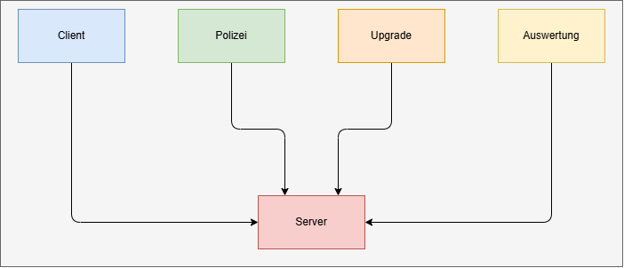
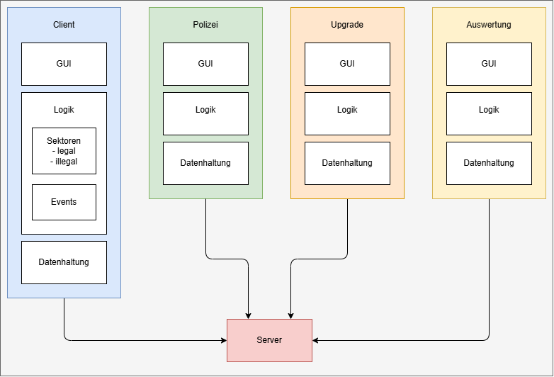

# Architektur Dokumentation

## Generelle Übersicht

### Datei-Erklärung

Hier eine kurze Erklärung und Beschreibung der Dateien und wofür sie da sind.

|   Datei   | Kurzbeschreibung                                                                                                                                                                                                                      |
|:---------:|---------------------------------------------------------------------------------------------------------------------------------------------------------------------------------------------------------------------------------------|
| space.lpr | der Einstiegspunkt: Hier beginnt das Programm. Es startet die grafische Oberfläche und lädt das Hauptfenster.                                                                                                                         |
| Unit1.pas | der Hauptteil der Spiellogik: unter anderem RFID-Eingabe, Spieler- und Schiffsdaten, Aufträge, Be- und Entladen sowie Dateizugriffe. .pas ist hier schlicht die Pascal-Quellcodedatei. |
| Unit1.lfm | der Bauplan des Hauptfensters: welche Elemente wie Labels, Eingabefelder und Anzeigen es gibt und wo sie liegen. Die Datei enthält nicht die eigentliche Spiellogik. (Winform)                                                        |
| space.lpi | die Projektdatei für Lazarus. Sie legt unter anderem fest, welche Dateien zum Projekt gehören und für welches Zielsystem gebaut wird. Lazarus ist die Entwicklungsumgebung, mit der das Programm gepflegt und kompiliert werden kann. |
| space.ini | Einstellungen für den konkreten Rechner: Sektornummer und Pfade zu Laufwerk sowie Serververzeichnissen. So kann dieselbe Programmversion auf verschiedenen Sektorrechnern unterschiedlich eingerichtet werden. |
| use.bat   | ein Windows-Hilfsskript zum Verbinden von Netzlaufwerken; es ist keine Spiellogik.                                                                                                                                                    |

### Nicht mehr benötigte Dateien

- rfid.txt
- space.cfg
- space.dof
- Unit1.ddp

### Aktuelle Architektur

Die aktuelle Architektur beinhaltet 4 unabhängige Programme, welche alle auf die gleiche Datenhaltung zugreifen. Diese Datenhaltung ist ein Netzlaufwerk und die Daten werden in einzelnen Dateien gespeichert. Dadurch entsteht eine große Anfälligkeit für Abstürze oder Dateikorruption wenn gleichzeitig auf dieselbe Datei zugegriffen wird.

## Initiale Vorgehensweise

Das Programm wird erstmal in Module zerlegt.  
Jedes einzelne Modul kriegt seinen eigenen Unterordner.  
Die einzelnen Module werden später wieder passend zusammengeführt.  

Die Module sind:

- Datenhaltung
- Darstellung
- Logik
  - Client
    - Sektoren
        - (Il-)Legal
    - Events
  - Polizei
  - Auswertung
  - Upgrade

## Architekturideen

Allgemein gibt es mehrere Endpunkte, als die eine Anwendung fungieren kann:

- Sektor
  - Legal
  - Illegal
  - Werft (Upgrade)
- Polizei
- Auswertung

Es muss festgelegt werden, als welcher eine ausgeführte Anwendung fungiert und auf welchen Datenendpunkt alle am Ende zugreifen.

### Einzelprogramm

Alles wird in eine Anwendung kompiliert.
Beim Aufsetzen des Spiels kann man auswählen, welche Funktion die aktuelle Anwendung ausführen soll.

### Individuelle Programme

Jeder Endpunkt wird in ein eigenes Programm kompiliert.  
Je nach gewollten Nutzen wird das entsprechende Programm auf einem Gerät ausgeführt.

## Architekturziel

Es wurde sich für das erhalten der einzelnen Programme entschieden. Zur Diskussion stehen hierbei noch die mögliche Integration des Upgrades in das Client Programm, da es sich hierbei um einen Spielinhalt handelt.